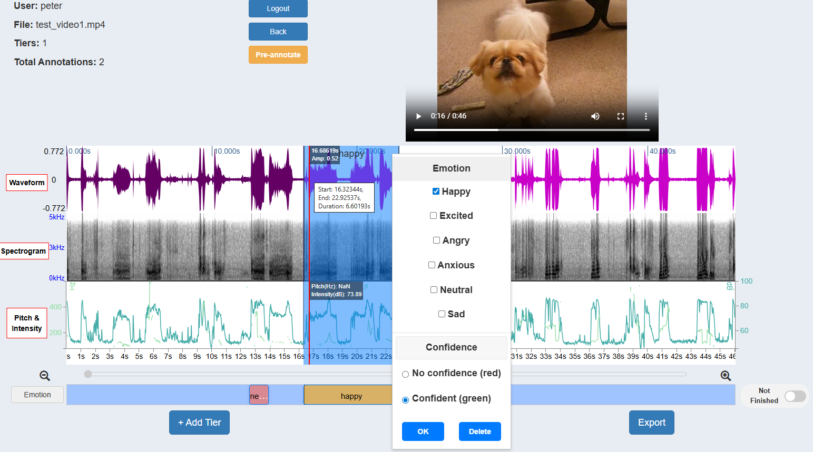
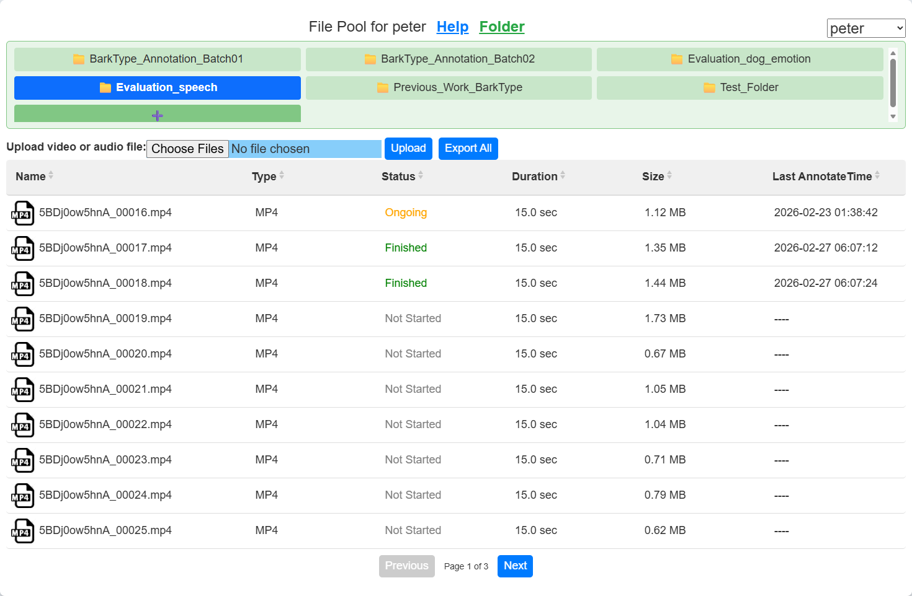

# Praat++: Multimedia Annotation System for Speech and Vocalization

**Accepted at ACL 2026 System Demonstrations.**  
Paper: https://aclanthology.org/2026.acl-demo.80/

*Praat++* is a browser-based multimedia annotation system for speech and vocalization data. It supports time-aligned audio and video annotation with waveform, spectrogram, pitch, intensity, synchronized video playback, TextGrid import/export, file-pool management, and AI-assisted pre-annotation.

The system is inspired by [Praat](https://www.fon.hum.uva.nl/praat/) and extends Praat-style annotation workflows to a collaborative web-based environment.

## Example





## Key Features

### User and File Management

- Role-based user management with regular annotators and superusers.

- Personal file pool for uploading, deleting, organizing, and tracking annotation files.

- Folder-based task management for different annotation tasks or groups.

- File metadata display, including file type, annotation status, duration, size, and last saved time.

- File locking with heartbeat updates to prevent simultaneous editing conflicts.

### Multimodal Annotation Workspace

- Browser-based annotation for audio/video files.

- Synchronized waveform, spectrogram, pitch, intensity, and video playback.

- Adjustable acoustic views, including configurable spectrogram.

- Real-time acoustic feedback when hovering over the timeline, including time, pitch, intensity, and waveform amplitude.

- Region-based annotation with drag-to-create, resize, move, playback, label editing, and deletion.

- Tier-based annotation with custom label categories and region-level confidence control for different information layers, such as emotion, behavior, or vocalization type.

### TextGrid Support

- Import TextGrid files together with matching media files or for media files already in the file pool.

- Export annotations to Praat-compatible `.TextGrid` files.

- Batch export of annotation data from the file pool.

### AI-Assisted Pre-Annotation

- PANNs-based pre-annotation for generating candidate annotation regions.

- Configurable event label, threshold, minimum duration, and target tier.

- Human-in-the-loop review and refinement of AI-generated annotations.

### Auto-Save and Statistics

- Automatic saving and loading of annotation progress.

- Preliminary statistics page for user-level file counts, folder-level progress, and custom category summaries.

**For a system walkthrough, please refer to the [Praat++ demo video](https://www.youtube.com/watch?v=YboCoBRF5lg).**

## Annotation Storage

Praat++ stores uploaded media files, annotations, and generated processing files separately for each user and folder-based task.

The general storage structure is:

```text
static/videos/pool/{user}/{folder_name}/{file_name}
```

Each uploaded file is saved under the logged-in username and selected folder. Annotation progress is stored independently for each user, folder, and media file.

## Try It Out

You can run Praat++ locally by following these steps:

### 1. Clone the Repository

```bash
git clone https://github.com/UTA-ACL2/PraatPlusPlus.git
cd PraatPlusPlus
```

### 2. Create and Activate Virtual Environment

```bash
python -m venv venv
# On Windows:
venv\Scripts\activate
# On macOS/Linux:
source venv/bin/activate
```

### 3. Install Required Packages

```bash
pip install -r requirements.txt
```

### 4. Set Up External Tools and Models

- Install [`ffmpeg`](https://ffmpeg.org/) and ensure it is added to your system `PATH`.
- For PANNs-based pre-annotation, prepare the [`PANNs`](https://zenodo.org/records/3987831) pretrained weights and place them under:

```text
app/ai/panns/
├── Cnn14_DecisionLevelMax.pth
└── Cnn14_mAP=0.431.pth
```

The model weight files are not included in this repository and should be prepared separately.

### 5. Configure User Accounts

Open `app/routes/login_routes.py` and define allowed usernames and roles in the user account configuration.

### 6. Run the Flask App

```bash
python run.py
```

### 7. Open in Browser

Visit http://127.0.0.1:5000 to use Praat++ locally.

## Paper and Citation

Praat++ is described in our ACL 2026 System Demonstrations paper:

**Praat++: Multimedia Annotation System for Speech and Vocalization**

Paper: https://aclanthology.org/2026.acl-demo.80/

If you use Praat++ in your research, please cite:

```bibtex
@inproceedings{zhang-zhu-2026-praat,
    title = "Praat++: Multimedia Annotation System for Speech and Vocalization",
    author = "Zhang, Weiran  and
      Zhu, Kenny Q.",
    editor = "Durrett, Greg  and
      Jian, Ping",
    booktitle = "Proceedings of the 64th Annual Meeting of the {A}ssociation for {C}omputational {L}inguistics (Volume 3: System Demonstrations)",
    month = jul,
    year = "2026",
    address = "San Diego, California, United States",
    publisher = "Association for Computational Linguistics",
    url = "https://aclanthology.org/2026.acl-demo.80/",
    doi = "10.18653/v1/2026.acl-demo.80",
    pages = "812--818",
    ISBN = "979-8-89176-392-0",
    abstract = "High-quality time-aligned annotation is fundamental to speech processing and animal vocalization research, yet precise boundary localization and consistent labeling remain challenging in collaborative settings. We present Praat++, a web-based multimedia annotation system designed for collaborative, video-informed, and AI-assisted timeline labeling of audio and video data. The system tightly synchronizes waveform, spectrogram, pitch, intensity, and time-aligned video playback with fine-grained region-based editing, enabling precise boundary refinement and improved label accuracy within a unified interface. Praat++ further incorporates role-aware workflow management and human-in-the-loop AI-assisted pre-annotation to enhance inter-annotator consistency and reduce labeling time. Through real-world multimodal speech and animal vocalization annotation scenarios, we demonstrate that Praat++ provides an integrated infrastructure for improving annotation quality and efficiency in dataset construction workflows. The demo video (https://www.youtube.com/watch?v=YboCoBRF5lg), website (https://redgiant.uta.edu/praat) and source code (https://github.com/UTA-ACL2/PraatPlusPlus) are now publicly available."
}
```

## Contact

**Peter (Weiran Zhang)**  
Email: wxz9630@mavs.uta.edu

## Acknowledgments

Praat++ was inspired by the design of *Praat on the Web* (Domínguez et al., 2016).  
We gratefully acknowledge their contribution to web-based speech annotation platforms.  

*Praat++* is developed by the [ACL Lab at the University of Texas at Arlington (UTA)](https://uta-acl2.github.io/).
